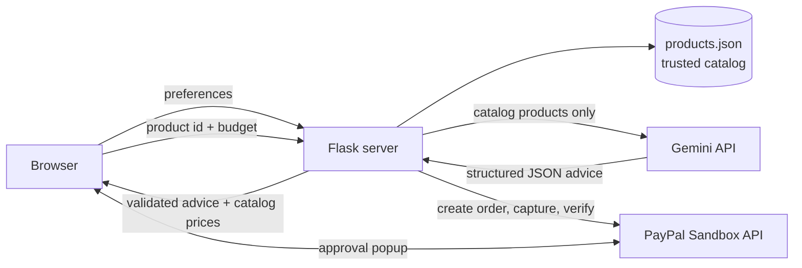
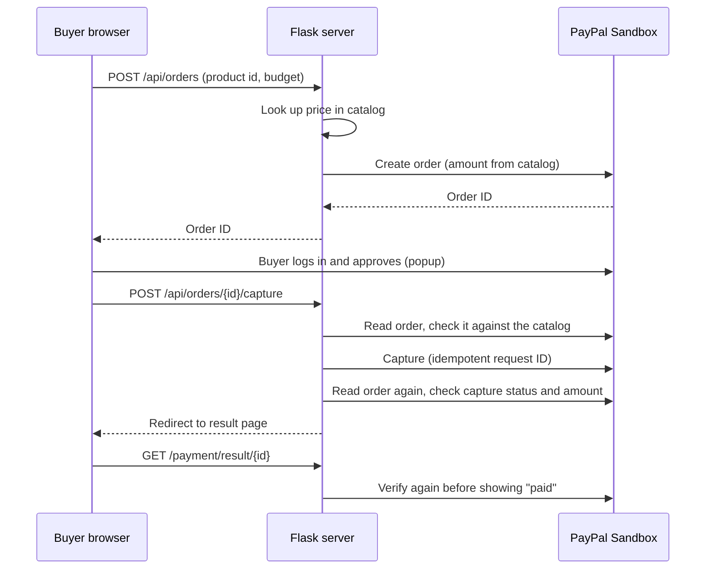

# SmartSpend AI

An AI-powered shopping assistant that helps people choose products within a budget, then pay through the **PayPal Sandbox**. Built for the PayPal AI Hackathon.

> **This is a prototype. All payments are PayPal Sandbox test transactions. No real money moves and nothing is shipped. The product catalog is made-up sample data.**

## What it does

1. The user picks a category, a maximum budget (USD), an intended use, preferences, and a priority (value, quality, or features).
2. The server filters the catalog and calculates remaining budget and over-budget amounts in Python.
3. **Google Gemini** explains why each in-budget product may suit the user, lists pros and cons, and names a best-value option.
4. The user can compare 2 or 3 products side by side (calculated in Python, no AI).
5. The user selects a product, reviews the order, and pays with **PayPal Sandbox Checkout**.
6. The server captures the payment, verifies it with PayPal, and shows a purchase summary.

## Architecture





## Where AI is used

Gemini receives only products from the catalog and returns structured JSON (a fixed schema). The server then validates the answer:

- Product IDs not in the catalog, or not within budget, are dropped.
- The AI is told never to write prices or totals. All money values shown come from the catalog and from Python calculations.
- User text is passed as data, with instructions to ignore any commands inside it.
- If every model fails, the page still works and shows catalog data with a warning. A fallback model can be configured.

## Where PayPal is used

- PayPal JavaScript SDK button on the review page.
- Orders API v2: the server creates the order, reads it back, and captures it.
- The server, not the browser, decides every amount and what counts as paid.

## Security design

- The PayPal **client secret** and Gemini key live only in `.env` on the server and are never sent to the browser.
- The browser sends only a product ID and a budget. The server recalculates the price from the catalog.
- The PayPal order is checked against the catalog (product, amount, currency) before capture and again afterwards.
- Success is shown only after PayPal confirms the capture status is `COMPLETED` and the amount matches.
- Duplicate captures are prevented by a per-order lock, an idempotent PayPal request ID derived from the order ID, and handling of `ORDER_ALREADY_CAPTURED`.
- The result page is shown only to the browser session that made the payment.
- Order IDs are format-checked before use. Budgets reject `nan`, `inf`, negatives, and text.
- No card details are collected or stored by this app.

## Tech stack

Python (Flask), HTML/CSS/JavaScript with Bootstrap, Google Gemini API (`google-genai`), PayPal Sandbox (JavaScript SDK and Orders API v2), `python-dotenv`, `requests`, `pydantic`.

## Project structure

```
smartspend-ai/
├── app.py                      # Flask routes
├── requirements.txt
├── .env.example                # placeholders only
├── LICENSE
├── data/products.json          # sample catalog (trusted prices)
├── services/
│   ├── catalog_service.py      # catalog lookup, budget math, comparison
│   ├── gemini_service.py       # Gemini call + validation
│   ├── paypal_service.py       # PayPal API client
│   └── payment_service.py      # verification and capture rules
├── templates/                  # HTML pages
├── static/                     # CSS and checkout.js
└── test_*.py                   # test scripts
```

## Setup (Windows PowerShell)

Requires Python 3.10 or newer (developed on 3.14).

```powershell
git clone https://github.com/riyabhadauria71-afk/smartspend-ai.git
cd smartspend-ai
python -m venv venv
.\venv\Scripts\Activate.ps1
pip install -r requirements.txt
Copy-Item .env.example .env
```

On macOS or Linux, activate with `source venv/bin/activate` and copy with `cp .env.example .env`.

If PowerShell blocks activation, run `Set-ExecutionPolicy -Scope CurrentUser -ExecutionPolicy RemoteSigned` once.

### Configure `.env`

| Variable | Where to get it |
| --- | --- |
| `FLASK_SECRET_KEY` | Generate with `python -c "import secrets; print(secrets.token_hex(32))"` |
| `GEMINI_API_KEY` | https://aistudio.google.com/apikey |
| `GEMINI_MODEL` | A current Gemini Flash model, see https://ai.google.dev/gemini-api/docs/models |
| `GEMINI_FALLBACK_MODEL` | Optional second model, used if the first fails |
| `PAYPAL_CLIENT_ID` | https://developer.paypal.com/dashboard, Apps & Credentials, **Sandbox**, your app |
| `PAYPAL_CLIENT_SECRET` | Same page, click Show |
| `PAYPAL_BASE_URL` | `https://api-m.sandbox.paypal.com` |

Put each value on one line after the `=`, with no quotes or brackets. Never commit `.env`.

## Run

```powershell
python app.py
```

Open http://localhost:5000.

## Testing the payment in the Sandbox

1. In the PayPal developer dashboard, open **Testing Tools, Sandbox Accounts** and use the **Personal** (buyer) account. Its email ends in `@personal.example.com`. Use **View/edit account** to see its login.
2. In the app: choose Headphones, budget `30`, click **Select Product** on ClearTalk Wireless Earbuds, then click the yellow **PayPal** button.
3. Log in with the sandbox buyer and approve.
4. You should land on a green "Payment verified" page showing 19.00 USD.

Never use real PayPal logins or real cards in the Sandbox. The seller (Business) account is not used to pay.

## Automated checks

```powershell
python test_end_to_end.py
```

This runs 36 checks covering input validation, tampered product IDs and budgets, comparison rules, AI failure handling, escaping of user text, missing PayPal credentials, and the result-page guard. **It replaces Gemini with a fake and makes no PayPal calls**, so it does not prove the live Gemini or PayPal integrations. Those are checked with:

```powershell
python test_gemini.py      # live Gemini call
python test_paypal.py      # live Sandbox authentication
```

## Troubleshooting

- **Gemini returns 404 for the model:** model names are retired over time. Check the current names and update `GEMINI_MODEL` in `.env`.
- **Gemini returns 503 "high demand":** this is temporary. Set `GEMINI_FALLBACK_MODEL`, or retry later. The app still shows catalog data.
- **PayPal login popup shows "Things don't appear to be working":** try an InPrivate or incognito window with browser extensions disabled. This fixed it during development. Make sure the popup address is `sandbox.paypal.com`.
- **PayPal asks for card details after you type an email:** you entered an email PayPal doesn't know. Use the sandbox Personal account email from the dashboard, never your real one.
- **`HTTP 401 invalid_client` from `test_paypal.py`:** the Client ID and Secret don't match a Sandbox app. Check for stray spaces, quotes, or brackets in `.env`.
- **App won't start with `FLASK_SECRET_KEY` error:** set a real random value in `.env`.

## Limitations

- The catalog is made-up sample data in USD. There are no live marketplace prices, reviews, or stock.
- Payments are Sandbox only. A production version would need Live credentials, a database for orders, webhooks, and a production server.
- Per-order locks work within one server process. Across several processes, duplicate captures are still prevented by PayPal's idempotent request ID and `ORDER_ALREADY_CAPTURED` handling.
- The Gemini model name may need updating if Google retires it.

## Development note

Built during the hackathon with AI assistance (Claude by Anthropic) used as a coding tutor and reviewer.

## License

MIT, see [LICENSE](LICENSE).